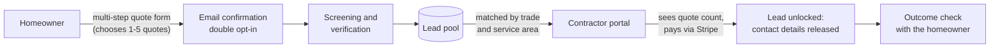

# LeadYard

**A lead marketplace that connects Southern Ontario homeowners with local trades contractors.**
Live at [leadyard.ca](https://leadyard.ca).

> This is a public showcase. The source code lives in a private repository. This README
> explains what the product does, how it is built, and the engineering decisions behind it.

---

## The problem

Most contractor lead services sell the same homeowner to several contractors without telling
any of them, and charge every one of them full price. Homeowners get flooded with calls, and
contractors pay for leads they never had a real chance to win.

## How LeadYard works

- **Homeowners choose how many quotes they want**, from one to five. No more than that number
  of contractors ever receive their details.
- **Contractors see the competition before they pay.** Every lead shows how many contractors
  are quoting it, and the price drops as that number rises.
- **Pay per lead, no contract.** No monthly fee and no minimum spend. Leads start at $15 CAD.

Coverage: the GTA, Durham, Hamilton, Niagara, Guelph, and Waterloo Region.
Trades: Handyman, Painting, Flooring, General Trades, and HVAC.

---

## Architecture

| Layer | Choice |
|---|---|
| Runtime | Node.js 20+, Express |
| Database | PostgreSQL 18, with timestamped migrations applied on every deploy |
| Frontend | Plain HTML, CSS, and JavaScript, with no build step. The contractor portal is server-rendered |
| Payments | Stripe Checkout in CAD, confirmed by webhook. Unlocks are idempotent |
| Auth | Passwordless magic links (single-use, 15-minute expiry) and 30-day sessions |
| Email | Provider-selectable (Resend or Zedmail) behind a single send function |
| File storage | S3-compatible private bucket. Photos are served through presigned URLs that expire |
| Analytics | Self-hosted Umami. No cookies, and no third-party tracking |
| Hosting | Canner, in Québec, Canada |

The codebase is layered strictly: route handlers never run SQL, the database layer never
handles HTTP, and every external service sits behind its own wrapper.

---

## Engineering decisions worth knowing about

### Canadian data residency, enforced in code
Homeowner data stays on Canadian infrastructure. Each external provider declares its own
jurisdiction. The published privacy policy's list of processors is **checked against the
providers the code actually uses**, so the policy cannot drift away from reality. An
unrecognised email provider setting refuses to send rather than quietly falling back to a
provider in another country.

### Public copy is tested against the code
Most of the test suite checks that the website tells the truth. Examples:
- Every service area the site advertises must be one a contractor can actually select.
- Every lead price quoted in marketing copy is recomputed from the pricing code.
- The thank-you page and confirmation emails may only make promises the system keeps.
- Structured data (JSON-LD) for search engines must match the copy people see on the page.

If a page promises something the code does not do, the build fails.

### The build fails rather than shipping something wrong
Every deploy runs about 90 test files before any migration runs, and runs them again across
six configuration profiles that mirror real production states. A red test means the previous
version keeps serving.

### Lead quality is built into the data model
- Homeowners confirm their email before a lead goes on sale.
- A screening step holds suspicious submissions for review.
- Leads expire after 30 days, and photos are deleted after 90.
- Each lead carries a development tier (Verified, Qualified, Scoped) that can only ever be
  raised, with a history table recording every change, so any price can be justified.

### Privacy by default
- Only contractors who pay for a lead see the homeowner's contact details.
- Photos are stored privately. Contractors see a blurred preview before they buy.
- Comments in page source are stripped before pages are served, so internal notes never ship
  to the browser.

---

## Also in the product

- **Contractor portal**: onboarding, matching leads, lead detail, account management, and an
  email digest of new matching leads.
- **Homeowner scoping flow**: an optional follow-up where homeowners add budget, timeline, and
  scope detail.
- **Cost guides**: SEO articles on GTA renovation costs, with sourced figures.
- **Operator tooling**: a review queue, an admin dashboard, and an email when a lead arrives
  that no contractor covers yet.
- **Ballpark** (built, not yet switched on): a cost-range estimator for kitchen and bathroom
  renovations, built on sourced cost tables. Its ranges are deliberately kept wide.

---

## Status

In production since 2026, with contractors onboarded in the GTA. Built and run by one person.

## About

Built by **Kirko Papajanis** under [KRROP](https://krrop.com).
More about me at [k18z.com](https://k18z.com).
